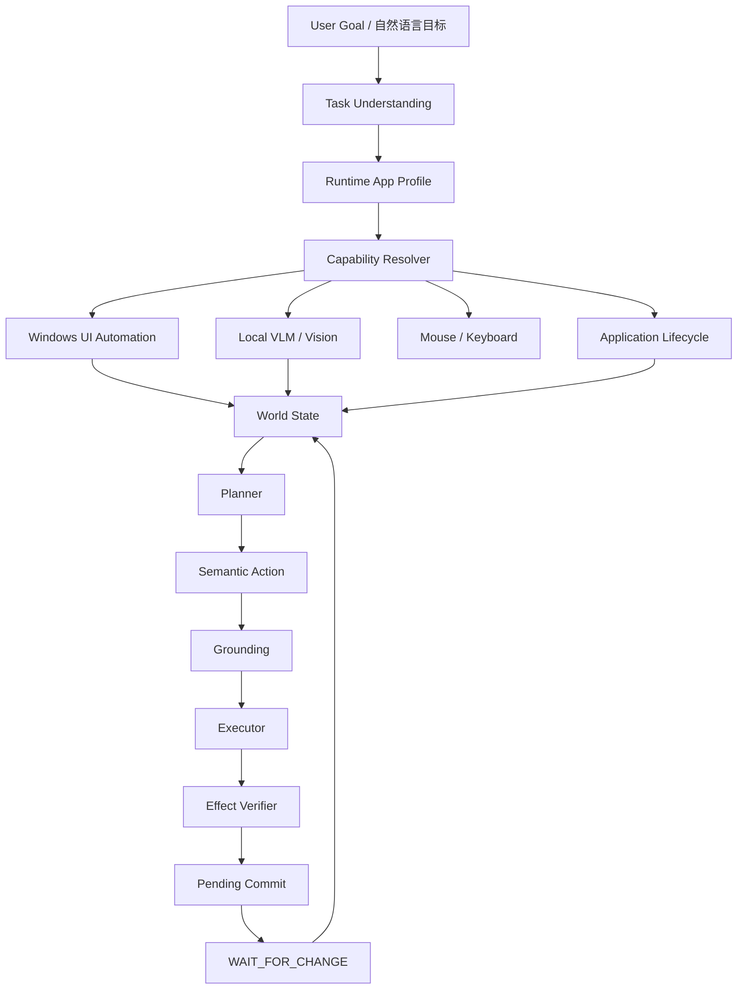

# CEH Windows UIA（木头自动系统控制）
### *Local AI Desktop Agent — Natural Language Windows Control*

<p align="center">
  <a href="assets/uppic/video/sm.mp4">
    
  </a>
</p>

<p align="center">
  <strong>让用户不再写自动化脚本，而是直接告诉电脑：“我要做什么。”</strong>
</p>

<p align="center">
  <a href="assets/uppic/video/sm.mp4"><strong>▶ 点击上方图片观看项目演示视频</strong></a>
</p>

<p align="center">
  
  
  
  
  
  
  
  
</p>

---

## 目录

- [一、项目概述与软件定位](#一项目概述与软件定位)
- [二、项目要解决的问题](#二项目要解决的问题)
- [三、核心功能](#三核心功能)
- [四、项目演示](#四项目演示)
- [五、系统架构](#五系统架构)
- [六、本地模型与运行机制](#六本地模型与运行机制)
- [七、硬件支持与运行环境](#七硬件支持与运行环境)
- [八、工程目录结构](#八工程目录结构)
- [九、快速开始与编译](#九快速开始与编译)
- [十、日志与安全边界](#十日志与安全边界)
- [十一、设计原则](#十一设计原则)
- [十二、当前限制与 Roadmap](#十二当前限制与-roadmap)
- [十三、免责声明与知识产权声明](#十三免责声明与知识产权声明)

---

## 一、项目概述与软件定位

**CEH Windows UIA（木头自动系统控制）** 是一个基于 **C++17 + Qt6 + Windows UI Automation + 本地 LLM/VLM + Visual Grounding + 鼠标键盘控制** 构建的 Windows 本地 AI 桌面智能控制系统。

本项目不希望为每一个软件单独编写自动化脚本，也不要求普通用户学习 UIA、AutomationId、坐标、RPA、宏命令等技术细节。

真正的目标只有一个：

> **用户正常说话，告诉电脑“用什么软件做什么”，系统自己理解当前窗口、自己观察、自己操作、自己验证。**

例如：

```text
打开 QQ
打开微信
和他聊天
和他聊天，问出他做什么职业
看看这个窗口里有什么
分析这张图片
```

系统执行：

```text
自然语言目标
→ 任务理解
→ 当前软件/窗口识别
→ UIA / Vision 能力判断
→ 目标定位
→ 鼠标键盘执行
→ 效果验证
→ 等待 / 继续 / 完成
```

> [!IMPORTANT]
> **Local-First / 本地优先**  
> 项目当前采用本地 `llama.cpp` 驱动 LLM / VLM。任务规划、窗口视觉理解、图片分析等能力可以在本机完成。

---

## 二、项目要解决的问题

### 1. 传统自动化太依赖固定脚本

传统 RPA 常常需要提前知道：

```text
软件叫什么
控件 ID 是什么
坐标是多少
按钮在哪里
下一步点击什么
```

软件版本或界面一变化，脚本就容易失效。

CEH Windows UIA 希望变成：

```text
用户只给目标
→ AI 自己观察当前界面
→ 自己决定下一步
```

### 2. 现代软件 UIA 经常不完整

Chromium、DirectUI、自绘控件、GPU UI、Canvas 等界面可能只返回很少的 UIA 节点。

例如：

```text
UIA nodes=2
actionable=0
```

系统会自动判定：

```text
UIA unavailable
```

并切换：

```text
Local VLM
→ Vision Target
→ VisionMouse
```

### 3. 单纯视觉点击不够可靠

视觉模型能够判断“按钮大概在哪里”，但坐标可能有偏差。

所以实际流程是：

```text
Vision
→ Grounding
→ Permission Check
→ Mouse Action
→ Effect Verification
```

### 4. AI 说“成功”不等于真的成功

例如：

```text
keyboard_type 成功
```

只说明文字输入成功，不代表消息已经发送。

因此系统增加：

```text
Pending Commit
Strict Verification
WAIT_FOR_CHANGE
```

把“AI理解”与“C++实际执行效果”分开。

---

## 三、核心功能

### 1. 自然语言控制电脑

用户无需了解：

```text
UIA
AutomationId
XPath
坐标
RPA
宏
脚本
```

只需要直接下达目标。

### 2. 桌面控制

开启桌面识别后可以执行：

```text
打开 qq
打开某个软件
查找目标程序
切换到目标窗口
```

桌面模式使用：

```text
DESKTOP_CONTROL
```

作为授权范围。

### 3. 指定窗口控制

用户手动选择窗口后，系统锁定：

```text
Process
PID
HWND
Window Rect
Window Title
```

指定窗口任务使用：

```text
WINDOW_CONTROL
```

只允许在用户选中的目标窗口范围内执行。

### 4. Windows UI Automation

支持读取：

- 控件树
- Name
- ControlType
- AutomationId
- Bounding Rectangle
- Actionable Nodes
- Top Level Window

UIA 不可靠时不会反复扫描，而是转视觉控制。

### 5. Local VLM / VisionMouse

本地 VLM 可以返回：

```json
{
  "screen_state": "当前处于聊天界面",
  "targets": [
    {
      "label": "消息输入框",
      "confidence": 0.95,
      "norm_x": 0.66,
      "norm_y": 0.93
    },
    {
      "label": "发送按钮",
      "confidence": 0.95,
      "norm_x": 0.89,
      "norm_y": 0.93
    }
  ]
}
```

之后由 C++ 将归一化坐标转换为真实屏幕坐标。

### 6. 鼠标键盘动作

当前基础动作：

```text
mouse_move
mouse_click
mouse_drag
mouse_path
keyboard_type
keyboard_hotkey
```

### 7. 自然聊天

聊天任务当前流程：

```text
当前会话
→ Vision 找输入框
→ 自动生成自然口语
→ keyboard_type
→ pending_commit
→ 定位发送按钮
→ 点击
→ 严格验证
→ WAIT_FOR_CHANGE
```

例如：

```text
用户：和他聊天，问出他做什么职业
```

系统可以生成：

```text
最近在忙什么呀？
```

后续继续：

```text
你现在是做什么工作的呀？
```

### 8. 当前会话保护

如果用户已经选择当前聊天窗口，没有明确指定新联系人：

```text
和他聊天
继续聊
问他做什么工作
```

默认：

```text
当前会话 = 用户目标
```

不会自行随机选择左侧联系人、群聊或服务号。

### 9. Pending Commit 提交事务

输入文字后不会直接判定发送成功。

```text
keyboard_type
↓
记录 lastTypedText
↓
pending_commit
↓
定位发送 / 提交按钮
↓
执行提交
↓
重新观察
↓
验证
```

发送按钮优先使用 `norm_rect` 几何中心；如果点击后文字仍存在，则继续重试，而不是直接进入等待。

### 10. WAIT_FOR_CHANGE

连续任务支持：

```text
发送消息
→ 等待回复
```

等待期间：

```text
没有变化
→ C++低频检测
```

检测到变化后：

```text
重新 Vision
→ 更新 World State
→ 继续任务
```

### 11. 用户图片与截图分析

支持普通图片和用户截图。

这一模式使用独立 Vision 提示词，直接返回自然语言，不返回 Agent 内部 JSON。

### 12. 应用启动生命周期

应用启动：

```text
Resolve Executable
→ Existing Window Check
→ Start Process
→ Wait PID
→ Wait HWND
→ Read Window Title
→ Confirm Ready
```

只有真实顶层窗口确认后才认为 GUI 应用启动完成。

---

## 四、项目演示

<p align="center">
  <a href="assets/uppic/video/sm.mp4">
    
  </a>
</p>

<p align="center">
  <a href="assets/uppic/video/sm.mp4"><strong>▶ 点击图片打开完整 MP4 演示</strong></a>
</p>

仓库演示资源：

```text
assets/uppic/video/sm.JPG
assets/uppic/video/sm.mp4
```

视频直链：

[assets/uppic/video/sm.mp4](assets/uppic/video/sm.mp4)

---

## 五、系统架构



核心职责：

```text
LLM      → 理解目标 / 规划 / 生成自然语言
VLM      → 理解屏幕 / 定位视觉目标
UIA      → 提供结构化控件信息
Grounding→ 把语义目标变成可执行位置
Executor → 真正操作鼠标键盘
Verifier → 判断动作有没有真正生效
```

---

## 六、本地模型与运行机制

当前主要使用：

```text
llama.cpp
```

测试模型：

```text
gemma-4-E4B-it-Q4_0.gguf
```

视觉投影：

```text
mmproj-gemma-4-E4B-it-Q8_0.gguf
```

### LLM 典型参数

```text
Host        127.0.0.1
Port        8888
Context     16384
Threads     12
GPU Layers  42
Batch       256
UBatch      64
```

### VLM 典型参数

```text
Host        127.0.0.1
Port        8889
Context     8192
Threads     12
GPU Layers  42
Batch       256
UBatch      64
```

VLM 按需加载，减少长期显存占用。

---

## 七、硬件支持与运行环境

### 当前主要测试环境

| 项目 | 环境 |
| :--- | :--- |
| 操作系统 | Windows 10 64-bit |
| CPU | Intel Core i9-9900KF |
| 内存 | 32 GB |
| GPU | NVIDIA GeForce RTX 3080 10 GB |
| C++ | C++17 |
| 编译器 | MSVC |
| Qt | Qt 6.11.1 |
| OpenCV | OpenCV 4.x |
| IDE | CLion |
| AI Runtime | llama.cpp |
| Model | Gemma 4 E4B GGUF |

### 推荐配置

| 级别 | CPU | RAM | GPU | 适用场景 |
| :--- | :--- | :--- | :--- | :--- |
| 基础 | 现代 6 核以上 | 16 GB | 可无独显 | CPU 小模型、基础自动化 |
| 标准 | 8 核 / 16 线程 | 32 GB | RTX 3060 级 | 推荐本地 LLM/VLM |
| 高性能 | i7/i9 / Ryzen 7/9 | 32 GB+ | RTX 3080/4070/4080/4090 | 更高速度、更大上下文 |

### Runtime

```text
runtime/
└── Windows/
    ├── cpu/
    ├── cuda13/
    └── vulkan/
```

大型 Runtime DLL 建议使用 **Git LFS**。

---

## 八、工程目录结构

```text
CEH_Windows_Uia/
│
├── CMakeLists.txt
├── README.md
├── main.cpp
├── resources.qrc
│
├── assets/
│   ├── config/
│   │   ├── agent.json
│   │   ├── app.json
│   │   ├── app_capabilities.json
│   │   ├── camera.json
│   │   ├── permissions.json
│   │   └── tools.json
│   ├── db/
│   │   └── wood.db
│   ├── font/
│   ├── models/
│   │   └── prompts/
│   ├── style/
│   │   └── main.qss
│   └── uppic/
│       ├── log/
│       └── video/
│           ├── sm.JPG
│           └── sm.mp4
│
├── platform/
│   ├── Windows/
│   └── macOS/
│
└── runtime/
    └── Windows/
        ├── cpu/
        ├── cuda13/
        └── vulkan/
```

---

## 九、快速开始与编译

### 开发环境

```text
Windows 10 / 11 x64
Visual Studio / MSVC
CMake
Ninja
Qt 6.11.1
OpenCV
CLion
```

### CMake

```powershell
cmake -S . -B cmake-build-debug -G Ninja
```

构建：

```powershell
cmake --build cmake-build-debug --target CEH_Windows_Uia -j 14
```

CLion：

```text
Build → CEH_Windows_Uia
```

### Git LFS

Runtime 含大型 DLL 时：

```powershell
git lfs install
git lfs track "runtime/**/*.dll"
```

模型文件：

```text
*.gguf
```

建议不要作为普通 Git 文件提交。

---

## 十、日志与安全边界

日志默认：

```text
assets/uppic/log/
```

主要记录：

```text
启动
模型加载
CPU / RAM / GPU
任务理解
Runtime Profile
Capability
UIA
Vision
Planner
Grounding
Mouse / Keyboard
Pending Commit
Verifier
WAIT_FOR_CHANGE
任务完成
```

安全模式：

```text
DESKTOP_CONTROL
WINDOW_CONTROL
```

指定窗口任务严格限制在用户主动选择的 HWND 范围。

### Generation Cancel

任何新任务、模式切换、新窗口选择都会建立新的 `generation`。

旧任务的推理结果、回调和待执行动作全部失效。

---

## 十一、设计原则

### 1. AI 理解，C++ 执行

```text
AI
→ 理解任务
→ 理解画面
→ 生成意图

C++
→ 权限检查
→ 坐标检查
→ 鼠标键盘
→ 进程控制
→ 效果验证
```

### 2. 不为单个软件写死流程

项目尽量使用：

```text
输入框
按钮
列表
窗口
发送
确认
提交
```

这些通用语义。

### 3. UIA 与 Vision 互补

```text
UIA + Vision + Mouse + Keyboard + Verifier
```

### 4. 不相信单次模型输出

模型说成功，不代表执行层真的成功。

系统还需要验证窗口、UIA、视觉变化、输入区状态、进程与 HWND。

---

## 十二、当前限制与 Roadmap

### 当前限制

- VLM OCR 可能出现漏字、错字和人名误识别；
- 自己消息 / 对方消息方向仍需继续增强；
- 小按钮、窗口边框、DPI、多显示器可能影响坐标精度；
- 自绘软件可能需要完全依赖 VisionMouse；
- 小型本地模型可能出现 JSON 字段遗漏和长任务上下文丢失。

### Roadmap

- [ ] 更稳定地区分自己消息 / 对方消息
- [ ] 更强聊天正文 OCR
- [ ] 更准确 `norm_rect` Grounding
- [ ] UIA + Vision 融合
- [ ] DPI 缩放增强
- [ ] 多显示器增强
- [ ] 更快 LLM/VLM 切换
- [ ] 长任务稳定性增强
- [ ] Application Profile 缓存
- [ ] 更多普通 Windows 软件控制
- [ ] Vulkan Runtime 完善
- [ ] Linux / macOS 后端探索

---

## 十三、免责声明与知识产权声明

### 1. 知识产权

本项目软件设计、源代码、UI 设计、Agent 运行逻辑、自动控制流程及相关工程实现的知识产权归项目作者 / 权利人所有。

未经明确授权，不得恶意篡改项目来源、冒用作者身份或用于违法用途。

### 2. 自动控制风险

桌面自动化可能产生错误点击、错误发送、文件覆盖、软件状态改变或数据变化。

请仅在自己或明确授权的设备、窗口和软件中使用。

### 3. AI 输出

LLM / VLM 属于概率模型，不保证所有识别和决策始终正确。

项目通过权限检查、Grounding、Pending Commit、Verifier 等机制降低风险，但不能保证完全消除模型误判。

### 4. Local-First

项目设计方向为本地优先。

如果用户自行配置第三方在线 API、云模型或外部服务，对应数据处理方式由第三方服务决定。

---

<p align="center">
  <strong>CEH Windows UIA · 木头自动系统控制</strong><br>
  <em>Natural Language → Windows Control</em>
</p>

<p align="center">
  <strong>Copyright © 2026. All rights reserved.</strong>
</p>
