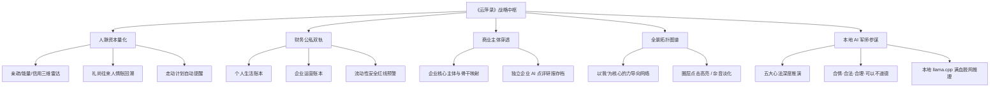
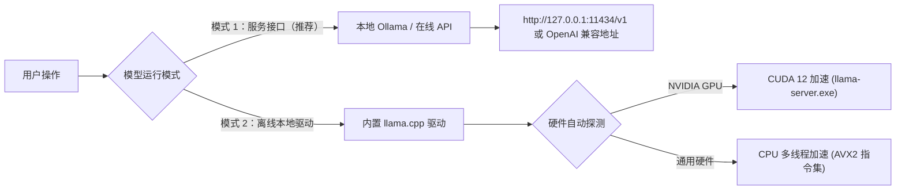
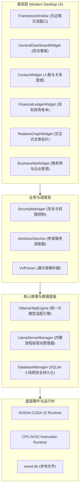

# 云萍录（社会关系与商业财务参谋系统）
### *SocialRelations — Private Social Capital & Financial Strategy System*

<p align="center">
  
</p>

<p align="center">
  <strong>深谙底层人性与利益博弈的本地隐私级「人脉资本 × 商业财务」桌面级智囊决策中枢</strong>
</p>

<p align="center">
  
  
  
  
  
  
  
</p>

---

## 目录
- [一、 项目概述与软件定位](#一-项目概述与软件定位)
- [二、 深刻的社会痛点](#二-深刻的社会痛点)
- [三、 核心解决方案与价值创造](#三-核心解决方案与价值创造)
- [四、 核心功能模块全景](#四-核心功能模块全景)
  - [1. 综合态势大屏（General Dashboard）](#1-综合态势大屏general-dashboard)
  - [2. 人脉与社会关系管理（Contact & Social CRM）](#2-人脉与社会关系管理contact--social-crm)
  - [3. 企业商务网与主体穿透（Business Network）](#3-企业商务网与主体穿透business-network)
  - [4. 全景交互式人脉拓扑图谱（Interactive Topology Graph）](#4-全景交互式人脉拓扑图谱interactive-topology-graph)
  - [5. 个人与公司双轨财务账本（Financial Ledger）](#5-个人与公司双轨财务账本financial-ledger)
  - [6. AI 私人幕僚中枢与双引擎驱动（AI Advisor System）](#6-ai-私人幕僚中枢与双引擎驱动ai-advisor-system)
  - [7. 数据安全与隐私护城河（Security & Encryption）](#7-数据安全与隐私护城河security--encryption)
- [五、 硬件支持与运行环境配置](#五-硬件支持与运行环境配置)
- [六、 技术架构与工程实现](#六-技术架构与工程实现)
- [七、 工程目录结构](#七-工程目录结构)
- [八、 快速开始与编译部署指南](#八-快速开始与编译部署指南)
- [九、 免责声明与知识产权声明](#九-免责声明与知识产权声明)

---

## 一、 项目概述与软件定位

**《云萍录（社会关系与商业财务参谋系统）》**（内部代号：`SocialRelations`）是由**台州木头智能科技有限公司**自主研发的 Windows 64位高性能桌面系统。

在商业博弈与复杂社会网络中，人脉不仅是通讯录里的名字，财务也不仅是冷冰冰的数字——**人脉的本质是势能与利益的流动，财务的本质是生存与博弈的筹码**。《云萍录》融合中国传统权谋心法与西方经典行为心理学，打造了一套**集人脉资本沉淀、动态亲疏追踪、礼尚往来人情账、双轨财务核算、交互式全景拓扑图、企业主体穿透以及本地隐私级离线 AI 军师于一体**的综合战略操作系统。

> [!IMPORTANT]
> **绝对的隐私优先（Local-First & Privacy-Obsessed）**：  
> 本系统坚持 100% 数据本地化架构。所有通讯录、资金流水、欠款账目、人际评价与企业资料均持久化存储于本机加密 SQLite 数据库中。无需连接任何第三方云平台，更无任何后台数据上传，在完全断网环境下依然可流畅运行满血 AI 商业推演。

---

## 二、 深刻的社会痛点

在当今瞬息万变的经济周期与高承压商业环境下，创业者、中小微企业家、商务精英以及自由职业者普遍面临以下严峻的社会痛点：

### 1. 人脉资产碎片化与“低效无效社交”泛滥
* **名单躺平落灰**：手机通讯录、微信中躺着几百上千个联系人，逢年过节群体群发，日常缺乏深层交互记录；
* **价值盲区与精力损耗**：区分不清谁是真正能为事业“滋养赋能”的贵人，谁是只会“消耗吸血”的劣质交往，常年陷入自我感动式的无效社交；
* **礼尚往来与走动脱节**：人情往来账目混乱、红白喜事赠礼回礼漏记错记，导致人际关系埋下嫌隙；拜访走动缺少周期性规划。

### 2. 个人账与公司账深度混同，资金链暗藏猝死危机
* **公私不分**：中小微企业主经常“公账私账一张卡”，自以为公司在赚钱，年底核算却发现家庭负债累累；
* **假性繁荣与流动性黑洞**：大量精力被表面应收账款（浮盈）麻痹，忽视了隐蔽负债与月均刚性流出，一旦遭遇外部催款或回款逾期，极易导致现金流瞬间断裂。

### 3. 当局者迷，缺乏冷静、狠辣、直面人性的顶级参谋
* **自我安慰与圣母心态**：面对复杂的生意合作、股权博弈、下属管理或借贷催款，当事人容易感情用事或受道德绑架，在关键博弈中下不去狠手、守不住底线；
* **缺乏客观推演中枢**：身边缺乏深谙人性暗面、能依据当事人真实财务现状与人际能量对比，量身定制出务实、管用、直击痛点的破局策略军师。

### 4. 云端 SaaS 工具存在严重的隐私泄露与商业机密出境隐患
* 核心客户人脉资料、企业真实营收、借贷债务明细是个人与企业的生命线；
* 使用公有云 CRM、云记账或直接调用公共云端大模型 API，数据极易被服务端抓取、留存、甚至因合规审查导致封号封库，存在致命的商业机密外泄风险。

---

## 三、 核心解决方案与价值创造

针对上述痛点，《云萍录》构建了五维一体的闭环解决方案：



| 核心维度 | 传统模式 / 常见软件 | 《云萍录》解决方案 |
| :--- | :--- | :--- |
| **人脉管理** | 静态电话簿，无动态评价与人情追踪 | 引入**亲疏度、能量值、信用星级**三维动态量化，配备五星亲疏演进轨迹与礼尚往来台账 |
| **财务管理** | 买菜记账软件（单一）或繁重企业 ERP | **个人生活账本**与**工作公司账本**双轨并行，实时穿透资产盘点与流动性红线 |
| **商业决策** | 拍脑袋、感情用事、自我安慰 | 基于真实财务+人际实力，由 AI 出具血淋淋的博弈解法（恪守“八字真言”） |
| **数据资产** | 托管在第三方云端服务器，受制于人 | **100% 存储于本地 SQLite**，支持一键脱机离线备份与跨机无损迁移 |
| **大模型集成** | 强制绑定云端 API，面临网络/泄密限制 | **首创双架构**：既可无缝对接本地 Ollama/在线接口，又可纯离线调用内置 `llama.cpp` + GGUF |

---

## 四、 核心功能模块全景

### 1. 综合态势大屏（General Dashboard）
* **资产配置与流动性全景**：一眼掌控个人总流动资金（当前资金 - 负债承压）、公司总流动资金、当前总负债与应收款项分布；
* **近 30 日收支对比图表**：多维度柱状图与趋势折线图，直观映射近期资金动态与消费峰值；
* **固定资产与投资管理**：支持房产、车辆、股权、黄金、设备等资产建档登记，支持一键变现核算与价值评估；
* **【AI 人生规划与战略推演】**：
  * 基于当前数据库中的真实收支底牌，融合《鬼谷子》《易经》《人性的弱点》《影响力》《金钱心理学》五大心法；
  * 血淋淋剖析当前财务风险隐患、人性盲点，给出未来 1~3 个月最具确定性的行动纲领与生存底线。

### 2. 人脉与社会关系管理（Contact & Social CRM）
* **全要素通讯档案**：涵盖姓名、单位、职位、行业分类、现居地、关系标签、联系电话及多维备注；
* **三维关系量化模型**：
  * **亲疏度（1~5 分）**：衡量利益捆绑深度与心理防线距离；
  * **能量值（1~5 分）**：客观评估对方在社会、职场、财富上的调动能力与势能；
  * **信用星级（1~5 星）**：基于历史履约、借贷还款、兑现承诺程度严格评级；
* **五星亲疏演变轨迹**：记录两人从陌生、破冰、升温、紧密到疏远、制约的动态变化历史；
* **礼尚往来人情台账**：精准记录每次人情礼品或资金往来（送礼/收礼、金额、事由、赠送人、日期），随时复盘利益进出账；
* **走动拜访规划系统**：设立拜访周期与待办走动，系统在左侧侧边栏自动按临近日期高亮提醒；
* **【联系人 AI 点评与无限追问】**：
  * 针对特定联系人，对比我方财务现状与对方能量对比，穿透其表面客套；
  * 提供务实狠辣的防坑自保策略、关键利益抓手与制衡话术；
  * 底部提供咨询表单，支持针对该联系人进行多轮深入博弈咨询。

### 3. 企业商务网与主体穿透（Business Network）
* **法人主体与企业档案库**：收录企业名称、统一社会信用代码、法定代表人、注册资本、所属行业、经营状态与实际控制人；
* **组织骨干人际穿透**：将通讯录联系人与企业主体进行关联挂钩（标注担任职务与权重），理清企业背后的真实人际网；
* **选中状态智能识别**：公司列表中当前选中的企业即刻呈现高亮主题色，杜绝资料误读；
* **【企业专属 AI 点评报告与独立持久化存档】**：
  * 深度推演该企业与核心操盘手对我方生意的实际赋能价值与潜在吸血风险；
  * 生成的企业战略报告自动以公司唯一 ID 独立保存为：  
    `assets/uppic/json/{公司ID}.json`
  * 下次进入商务网点击该公司时**瞬间秒级调出历史研报**，既可直接阅读，也可在已有研报基础上继续发起无限多轮商业咨询；重新点击生成则自动覆盖更新。

### 4. 全景交互式人脉拓扑图谱（Interactive Topology Graph）
* **力导向物理引擎驱动**：采用自研弹簧引力图算法，以“我”为宇宙引力中心，多层辐射关联好友、商业伙伴、家族亲友与法人企业；
* **智能焦点聚焦与干扰淡化**：
  * **点击任意联系人**：系统瞬时聚焦该节点，仅高亮其直连人脉网络与关联线，其余无关节点自动变灰虚化，圈层脉络一览无余；
  * **点击“我”或空白处**：全景网络瞬间恢复全部高亮显示；
* **全屏大屏演示**：支持平移、无极滚轮缩放与节点拖拽回弹，直观展现个人庞大的社会资本版图。

### 5. 个人与公司双轨财务账本（Financial Ledger）
* **严格隔离的双账本体系**：
  * **个人生活账本**：涵盖生活开支、医疗赡养、投资收益、人情消费等；
  * **公司经营账本**：涵盖客户营收、采购成本、人员工资、税费开支、商务公关等；
* **添加记账智能联动**：在任一账本下点击添加，自动匹配所属账本属性并智能记忆归类；
* **时间跨度穿透分析**：支持按年、按月、按日灵活筛选财务流水；
* **记账背后的商业日记**：每一笔重要资金进出均支持关联财务备忘与商业动因日记，还原每一笔钱背后的决策逻辑。

### 6. AI 私人幕僚中枢与双引擎驱动（AI Advisor System）
系统提供工业级模型调度中枢，用户可在 [设置 -> 模型设置](file:///d:/桌面/project/CLion/社会关系/src/ui/ModelSettingsDialog.cpp) 中自由切换：



* **模式 1：本地 Ollama / 在线接口服务（推荐）**
  * 完美适配本机安装的 Ollama 服务（默认 `http://127.0.0.1:11434/v1`）或任意兼容 OpenAI 规范的局域网/云端大模型 API；
  * 界面专属“测试连接”功能，毫秒级探测远端服务连通性与模型清单；
  * 底座内置 **消息流规范化拦截净化器**，全面兼容 Qwen2.5、Llama-3、DeepSeek 等遵循严苛 Jinja 模板校验的现代化大模型，杜绝连续 System 提示词引发的 HTTP 500 异常。
* **模式 2：内置 `llama.cpp` 离线驱动（.gguf 本地模型文件）**
  * 免装外部大模型软件，只需在界面中点击“选择”指定任意 `.gguf` 格式大模型文件；
  * 系统自动从 `runtime/Windows/cuda12/` 或 `runtime/Windows/cpu/` 中调遣内置引擎并在后台极速装配运行；
  * 提供“校验引擎”专属功能，真实装载模型权重并探活 `/health` 探针；
  * 保存配置时后台**自动异步预热加载模型权重**，彻底消除首次对话长达数十秒的冷启动等待。
* **商业参谋全局统一规则控制**：
  * 全系统所有 AI 回复规则与提示词统一收敛在 [assets/models/models.json](file:///d:/桌面/project/CLion/社会关系/assets/models/models.json)；
  * 严格恪守核心参谋真言：**『合情、合法、合理、可以不道德』**，抛弃假大空的圣母说辞，提供真正管用、狠辣的博弈解法；
  * 铁律强制**纯中文优先输出**，绝不输出英文开场白或无效思考词；
  * 用户在 JSON 文件修改规则后，系统运行中**实时自动热重载生效**，无需重新编译。

### 7. 数据安全与隐私护城河（Security & Encryption）
* **系统密码锁屏**：采用不可逆哈希算法加密认证，防止离开电脑时数据被他人窥视；
* **本地数据库一键导出与备份**：一键将完整的 `wood.db` 导出至指定目录或移动存储介质；
* **标准化 VCF 通讯录导入/导出**：兼容 iOS / Android 手机通讯录 vCard 标准协议，支持大批量人脉无损迁移；
* **纯物理隔离**：程序不设远程遥测（Telemetry）、不含任何外部追踪埋点，真正的离线数据保险箱。

---

## 五、 硬件支持与运行环境配置

软件全面经过深度硬件调优与跨平台兼容性设计，支持极低配置环境下的基础流畅运行，以及高端硬件下的满血 AI 推理加速：

### 1. 操作系统要求
* **Windows 10 64-bit** (版本号 1809 及以上)
* **Windows 11 64-bit** (全部版本)
* *注：不支持 32 位操作系统及 Windows 7/XP。*

### 2. 硬件配置分级标准

| 配置层级 | 目标使用场景 | 处理器 (CPU) | 运行内存 (RAM) | 显卡 (GPU) | 磁盘存储空间 |
| :--- | :--- | :--- | :--- | :--- | :--- |
| **基础配置** | 运行日常功能：综合看板、财务记账、人脉网络、连接 Ollama 或云端 API | 64位双核 2.0 GHz 以上（Intel Core i3 / AMD Ryzen 3） | **4 GB** (建议 8 GB) | 集成显卡即可 | 至少 **500 MB** 可用空间 (SSD 推荐) |
| **标准离线配置** | 运行内置 llama.cpp + 7B/8B Q4 级 GGUF 本地大模型 (CPU 纯算) | Intel Core i5/i7 (8代+) / AMD Ryzen 5/7 (6核及以上) | **16 GB** | 集成显卡或普通独显 | **10 GB** 以上 (存放 GGUF 模型文件) |
| **满血旗舰配置** *(推荐)* | 满显存满血 GPU 加速离线推理，秒级长篇出具战略报告 | Intel Core i7/i9 / AMD Ryzen 7/9 | **32 GB** 及以上 | **NVIDIA GeForce RTX 3060/3080/4060/4070/4080/4090** (显存 ≥ 8 GB / 12 GB / 16 GB+) | 高速 NVMe M.2 SSD |

### 3. GPU 驱动与加速组件说明
* **NVIDIA CUDA 12 加速**：如果您的电脑配备了 NVIDIA 独立显卡并安装了官方显卡驱动，软件内置的 `runtime/Windows/cuda12/` 会自动启用 GPU 满血显存卸载（`-ngl 99`），**客户电脑无需额外部署 Python 或下载高达数 GB 的 CUDA Toolkit 开发包**。
* **CPU 降级兜底机制**：如果客户机没有 NVIDIA 显卡或驱动损坏，系统具备**智能自愈回退机制**，自动无缝切换至 `runtime/Windows/cpu/` 通用 CPU 推理，确保软件永远不卡死、不崩溃。

---

## 六、 技术架构与工程实现

《云萍录》严格遵循现代 C++ 工业软件标准打造，具备极高的运行效能与系统稳健性：



* **前端交互层**：
  * 基于 **Qt 6.11.1 (C++20, MSVC 2022/2026, 64-bit)** 架构；
  * 原生无边框拖拽窗口体系，支持 Windows 11 DWM 阴影与亚克力质感；
  * 全矢量化图标体系（[UiIcons.h](file:///d:/桌面/project/CLion/社会关系/src/ui/UiIcons.h)），完美适配 100%、125%、150%、200% 等全级别高 DPI 缩放。
* **数据持久层**：
  * 内置 **SQLite 3** 高性能数据库，配置 WAL（Write-Ahead Logging）写入并发保护；
  * 提供完善的数据库自动升级机制与 schema 版本控制。
* **构建与链接抗锁死工程方案**：
  * 在 [CMakeLists.txt](file:///d:/桌面/project/CLion/社会关系/CMakeLists.txt) 中首创添加 `PRE_LINK` 自动进程排查钩子，彻底终结了 CLion 调试期间重编译触发的 `LINK: fatal error LNK1104 / LNK1168` 文件锁定痛点；
  * 集成 CMake 自动化构建后部署脚本（`deploy_standalone.cmake`），编译后自动调用 `windeployqt` 拷贝核心 DLL、同步 `assets/` 资源目录并部署 `runtime/Windows/` 推理组件。
* **独立发行包支持**：
  * 配备专业的 **Inno Setup 7** 脚本（[CEH_Compilation.iss](file:///d:/桌面/project/CLion/社会关系/Compilation/CEH_Compilation.iss)）；
  * 内置 `VC_redist.x64.exe` 静默预装机制，一键生成免安装依赖的单体绿色安装程序。

---

## 七、 工程目录结构

```text
社会关系/
├── CMakeLists.txt                 # CMake 核心工程编译与跨版本部署控制配置
├── README.md                      # 本项目核心说明文档
├── main.cpp                       # 程序入口与 QApplication 启动中枢
├── resources.qrc                  # Qt 二进制静态资源清单
│
├── assets/                        # 核心运行静态资产
│   ├── config/                    # 软件基础配置文件
│   ├── db/
│   │   └── wood.db                # SQLite 业务核心主数据库文件
│   ├── img/                       # UI 位图素材与占位图
│   │   └── icon/                  # 软件 Logo 与高清 ICO 图标库
│   ├── models/
│   │   └── models.json            # 全系统大模型运行参数与参谋提示词全局配置文件
│   ├── style/
│   │   └── main.qss               # 全局现代化暗黑风格 QSS 样式表
│   └── uppic/
│       └── json/                  # 企业专属 AI 点评战略报告持久化存档 (公司ID.json)
│
├── src/                           # C++ 业务核心源码
│   ├── ai/                        # AI 大模型驱动与参谋逻辑
│   │   ├── AiAdvisorService.h/.cpp    # 参谋业务单例调度中枢
│   │   └── OllamaHttpEngine.h/.cpp    # 双引擎驱动器 (Ollama/API规范化 + llama.cpp进程宿主)
│   ├── core/                      # 基础核心工具与数据库交互
│   │   ├── DatabaseManager.h/.cpp     # SQLite 数据库底层读写与迁移
│   │   ├── SecurityManager.h/.cpp     # 安全鉴权、密码哈希与防篡改控制
│   │   └── VcfParser.h/.cpp           # VCF 通讯录导入/导出解析器
│   └── ui/                        # 用户界面与交互组件
│       ├── MainWindow.h/.cpp          # 软件主框架视窗
│       ├── TopBar.h/.cpp              # 顶部导航状态栏与 AI 状态流光指示灯
│       ├── GeneralDashboardWidget.h/.cpp # 综合态势大屏看板
│       ├── ContactWidget.h/.cpp       # 人脉与社会关系管理页面
│       ├── BusinessNetWidget.h/.cpp   # 企业商务网与主体穿透页面
│       ├── RelationGraphWidget.h/.cpp # 全景力导向交互式人脉拓扑图
│       ├── FinancialLedgerWidget.h/.cpp # 个人/公司双轨财务账本页面
│       ├── ModelSettingsDialog.h/.cpp # 大模型模式切换与硬件参数设置窗口
│       ├── SecuritySettingsDialog.h/.cpp # 安全设置密码修改窗口
│       └── ...                        # 对话框、卡片组件及自绘控件
│
├── runtime/                       # 内置本地大模型推理运行时
│   └── Windows/
│       ├── cpu/                   # 通用 CPU 推理 DLL 与 llama-server.exe
│       ├── cuda12/                # NVIDIA CUDA 12 GPU 满血加速 DLL (含 cuBLAS/cuBLASLt)
│       └── vulkan/                # 跨平台 Vulkan GPU 加速预留运行时
│
└── Compilation/                   # 独立发行与安装包打包目录
    ├── CEH_Compilation.iss        # Inno Setup 7 正式安装包打包脚本
    ├── VC_redist.x64.exe          # 微软官方 Visual C++ 2015-2022 x64 运行库
    ├── 安装与硬件要求.txt          # 发行说明文档
    └── Output/                    # 正式编译生成的安装包输出目录
        └── SocialRelations_Setup_v1.0.0_x64.exe # 最终交付安装程序
```

---

## 八、 快速开始与编译部署指南

### 1. 开发与编译环境要求
* **操作系统**：Windows 10 / 11 64-bit
* **编译器**：Microsoft Visual Studio 2022 或 2026 (MSVC v143/v144+, 需勾选 C++ 桌面开发)
* **CMake**：3.20 及以上版本
* **Qt 框架**：Qt 6.8+ 或 Qt 6.11.1 64-bit (`msvc2022_64`)
* **IDE**：CLion 或 Visual Studio 2022

### 2. 源码构建步骤（以 CLion / 命令行 为例）

1. **克隆或打开工程目录**：
   在 CLion 中打开工程根目录 `d:\桌面\project\CLion\社会关系`。

2. **配置 CMake Profile**：
   * 生成器推荐选择 `Ninja`；
   * 构建类型选择 `Debug` 或 `Release`；
   * 指定 Qt 安装前缀（例如：`-DCMAKE_PREFIX_PATH=C:/Qt/6.11.1/msvc2022_64`）。

3. **构建可执行文件**：
   在终端或 CLion 中执行目标构建：
   ```powershell
   # 载入 MSVC 64位编译环境后执行
   cmake --build cmake-build-release --target SocialRelations -j 14
   ```
   *注：构建完成后，CMake 会自动执行 `deploy_standalone.cmake`，在生成目录下完整部署所有 Qt 依赖、SQLite 驱动、`assets/` 资源目录与 `runtime/` 本地大模型驱动。*

4. **一键生成 Inno Setup 安装包**：
   ```powershell
   & "C:\Program Files\Inno Setup 7\ISCC.exe" "Compilation\CEH_Compilation.iss"
   ```
   安装包将自动输出至：  
   `Compilation\Output\SocialRelations_Setup_v1.0.0_x64.exe`

### 3. 本地大模型文件配置与使用

1. **准备 GGUF 模型文件**：  
   下载任意兼容 `llama.cpp` 的 `.gguf` 格式大模型文件（中文推荐：`Qwen2.5-7B-Instruct-Q4_K_M.gguf`、`Qwen2.5-14B-Instruct-Q4_K_M.gguf` ，英文的推荐`gemma-4.gguf` 或相关优秀商业模型）。建议将其存放于固态硬盘（如 `assets/models/` 目录下）。
2. **在软件中指定**：  
   启动软件，点击顶部右上角 **「模型」** 图标：
   * 将模式切换为 **「模式 2：内置 llama.cpp 离线驱动」**；
   * 点击右侧 **「选择」** 指定您下载的 `.gguf` 文件；
   * GPU 加速层数保持默认 `99`（全显存加速）；
   * 点击 **「校验引擎」**，系统将自动启动底层驱动并校验模型健康；
   * 点击 **「保存配置」** 即完成部署，立享满血离线智能参谋！

---

## 九、 免责声明与知识产权声明

1. **知识产权归属**：  
   本软件所有源代码、UI 界面布局设计、拓扑算法实现及商业参谋规则库之知识产权，均归属于**台州木头智能科技有限公司**所有。未经官方书面许可，任何个人或组织不得擅自反编译、破解、闭源转售或进行二次商业封装。

2. **商业决策免责**：  
   《云萍录》系统内所有由人工智能生成的分析报告、商业博弈策略、人脉点评与财务规划推演，均系依据大语言模型算法及提示词规则运算产出之**参考性辅助建议**，不构成任何具有法律效力的正式财务、法务、刑事或投资保证。用户应在遵守国家法律法规的前提下独立审慎决策，并自行承担由此引发的一切商业运营风险与民事责任。

3. **数据主权承诺**：  
   台州木头智能科技有限公司郑重承诺：本系统无任何云端后门与数据回传机制，用户在使用本软件过程中产生的全部人脉隐私、财务数据、企业信息与对话记录，均 100% 独立保存在用户本地设备中，真正将数据主权彻底交还给用户。

---

<p align="center">
  <strong>台州木头智能科技有限公司 · 版权所有</strong><br>
  <em>Copyright © 2026 Taizhou WOOD Intelligent Technology Co., Ltd. All rights reserved.</em>
</p>
